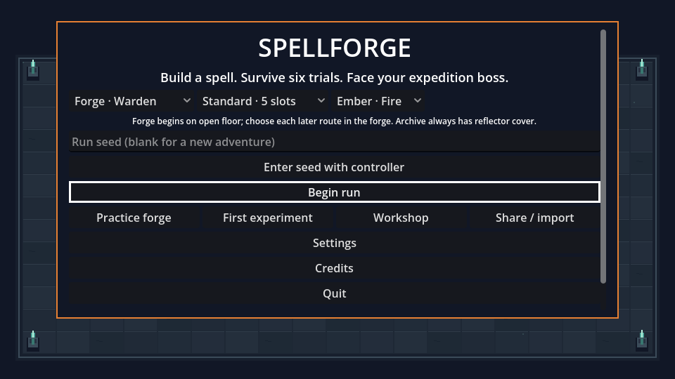
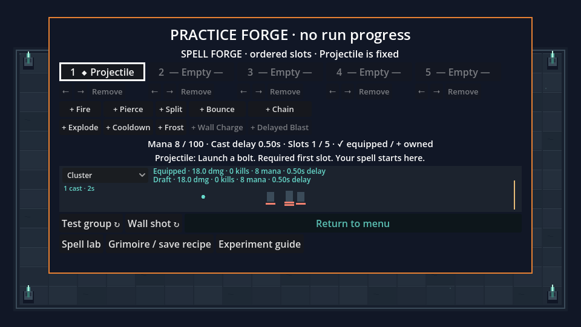
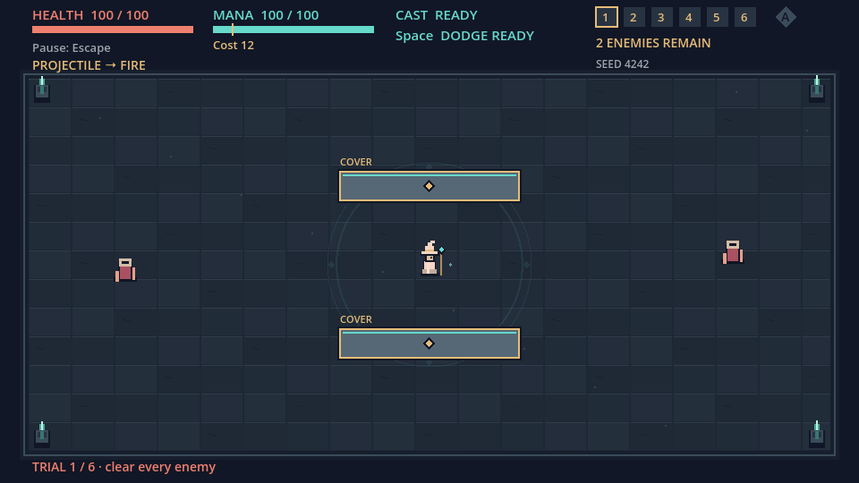

# Integrated roadmap validation — 2026-10-25

This page preserves the pre-review snapshot and its original source hashes. See [STACK_REVIEW.md](STACK_REVIEW.md) for the subsequent five-PR review, fixes, and current validation.

This records the reconstructed roadmap candidate based on `ad162de`, using the
official Godot `4.7.2.stable.official.ed1daf0bf` editor and matching export templates.
The original task ZIP remains unavailable; this evidence does not recover or
certify unknown SF-008–SF-029 requirements.

## Correctness and review

All 18 suite entry points passed: **98,040 numeric checks** across 17 suites,
plus the bounded stress suite's **10,000 casts / 800,000 contact attempts**.
Most numeric checks are deterministic director/geometry matrix checks, not
independent playtest cases. Engine/script-error and leaked-object log scans were
clean. The final preview label-spacing change was then verified by the preview
and experiment suites (69 and 426 checks), rendered captures and packaged smoke.
[Machine-readable results and source hashes](validation/roadmap-validation-20261025.json)
identify the checked content independently of later documentation/commit grouping.

The suites cover compiler semantics, progression, director, balance, controls,
UI, bounded resolution, report aggregates, registry, protected profile recovery,
sharing, previews, geometry, persistent journeys, bindings, complete Archive
runtime, integrated input and isolated experiments. The scripted Archive pilot
completed all seven rooms in 7,602 ticks using actual traveling spells and
navigation. It uses defensive invulnerability; it is not a balance or human
pacing result.

Independent reviewers ran through separate enforced read-only Codex CLI sessions,
with runtime model/effort and permission metadata checked. Data-contract findings
were corrected and rechecked. The final journey review found pending-seed loss,
lab rebuild focus loss and a fixed test fixture; all were corrected. The world
review found radial warning/damage disagreement behind cover; shared clipped
footprints now match damage and preview geometry. The original covered/uncovered
blast reproduction passes. A newer-version primary profile intentionally refuses
downgrade even when an older backup exists; it offers explicit no-save play.

Rendered inspection then exposed narrow wrapped menu shortcuts and stale focus
scrolling missed by earlier bounds tests. Equal-width shortcuts and guarded
post-layout reveal fixed the original capture. The input suite now has 324 checks,
including actual clipping intersections for focused controls, repeated menu paths,
960/1280 widths, normal/large text, seed export and nested lab focus. A real physical
controller has not been tested.

## Rendered and packaged evidence

Fourteen screens were captured at each of 960×540 and 1280×720, with clean exit
and no engine errors. Representative final captures:

Windows Desktop debug export succeeded. The same source was packaged as an
unsigned local macOS diagnostic: **19 headless and 20 rendered packaged smoke
checks passed**, including Archive, Archivist, Practice, experimental preview,
return flow, ordinary combat, license display and audio shutdown. The smoke entry
uses isolated save paths. The macOS diagnostic is not a signed/notarized release.
Windows execution was not available locally; hosted checks must be read at each
published PR head, and headless CI is not graphical Windows human acceptance.

The Mac export initially reported a missing template at Godot's fixed user-data
location and disabled ETC2/ASTC imports. Linking the already verified temporary
`macos.zip` at the required path and enabling ETC2/ASTC **only in the export copy**
resolved both errors; the original export command then succeeded. Repository
Windows settings were preserved. Artifact SHA-256 values are in the evidence JSON.

The original checkout and its unrelated work were preserved. Implementation,
validation fixtures and exports used an isolated worktree and separate temporary
baseline/export copies. Tests use unique save paths and clean only owned fixtures;
no player's profile is used for automated verification.

## Performance and acceptance

Three serialized repeats each of the base, candidate editor and actual debug
package completed with zero probe errors. All comparable casts/observed damage
matched. [PERFORMANCE.md](PERFORMANCE.md) reports every percentile range, limits
and the complete machine-readable results. Simulation overhead increased, while
boss completed-frame intervals exceed 16.67 ms in both baseline and candidate.
No speedup or target-hardware 60 fps acceptance is claimed.

Still open: original missing task specifications; human comprehension, build
viability, balance and voluntary replay; physical controller/reconnect and
keyboard-only participant journeys; crash/power-loss save injection; graphical
fresh-Windows and named target-hardware acceptance; Steamworks and explicit public
release approval. Optional lab rules remain candidates and never change ordinary
runs or saved recipe semantics. See [ROADMAP_GAPS.md](ROADMAP_GAPS.md) and
[PLAYTEST.md](PLAYTEST.md) for the full acceptance boundaries.
