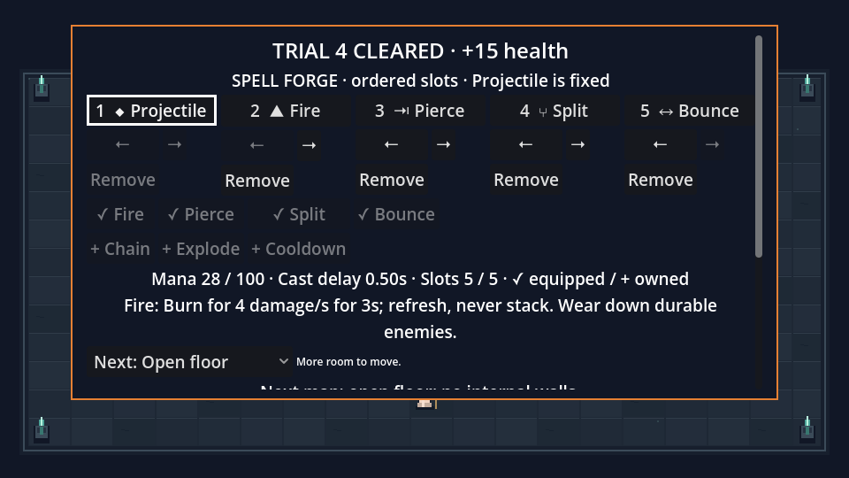

# Stacked PR review — 2026-10-25

Five independent reviews inspected PRs #21–#25 at their original heads and compared each layer with the integrated top. Review sessions enforced read-only access; runtime model, effort, and permissions were verified. Reproductions and fixes used separate writable copies, then the existing isolated delivery worktree. The original checkout and unrelated artifacts were preserved.

The review recorded 29 findings, including lower-confidence hypotheses. Twenty-five required changes; four journey findings were already resolved by later layers of the original stack. The latter are explicitly listed rather than counted as new fixes. This is a review of the complete stack; intermediate layers depend on the later feature integrations shown below.

## Findings and disposition

Severity and confidence are the original review assessments. Hypotheses were reproduced before changing code; physical-device behavior remains separate from synthetic input evidence.

| PR / finding | Severity / confidence | Observed problem | Disposition |
| --- | --- | --- | --- |
| 21.1 | P2 / high | A checkpoint could reopen a recorded current-room reward. | Reject contradictory reward eligibility; repeated Restore in a later room remains valid. |
| 21.2 | P2 / high | Empty pending offers could strand the reward screen. | Reject an unselected reward checkpoint without offers. |
| 21.3 | P2 / high | Evicted report history allowed totals below retained positive observations. | Enforce retained lower bounds, preserving legitimate saturation. |
| 21.4 | P2 / high | Complete report history could disagree with reward summaries. | Reconstruct complete summaries and require retained IDs in rolled-over summaries. |
| 21.5 | P3 / low hypothesis | Godot might repair malformed UTF-8 into an accepted share. | Confirmed with byte FF; reject invalid UTF-8 before conversion. |
| 22.1 | P1 / high | Persistent save failure blocked both advancing and suspending. | Explicit Continue without saving preserves the current run and existing saved bytes. |
| 22.2 | P2 / high | Retry lost challenge/starter setup. | Already resolved by the expedition layer's retry setup. |
| 22.3 | P2 / high | Exported next challenge differed from the next actual start. | Already resolved by later explicit setup and pending-seed integration. |
| 22.4 | P2 / high | Archive metadata could run Forge encounters. | Already resolved by the expedition layer's Archive director/runtime. |
| 22.5 | P3 / high | Editing reset the chosen preview fixture. | Preserve scenario through editing, inspection, and shortcut actions. |
| 22.6 | P3 / high | Invalid recipe input/full library appeared as storage failure. | Structured profile error classification distinguishes validation from storage failures. |
| 22.7 | P3 / high | Offline Practice exit skipped state restoration. | Already resolved by the controls layer's Practice action exclusion. |
| 23.1 | P2 / high | Grazing lane warnings included protected floor. | Clip the capsule and its details to visibility; protected/uncovered cases agree with damage. |
| 23.2 | P2 / medium hypothesis | Hidden Chain targets spent unperformed hops. | Confirmed; apply visibility before choosing/reserving hops, preserving open-floor selection. |
| 23.3 | P2 / medium hypothesis | Muzzle projection skipped a corner collision. | Confirmed target damage beyond the skipped contact; sweep the muzzle offset first. |
| 23.4 | P3 / high | Unequal-direction outer-corner reflection changed angle. | Reflect both outer-wall axes independently; retain rounded internal-corner normals. |
| 24.1 | P2 / high | Partial stick deflection shortened full-cost dodges. | Normalize dodge and retained aim directions; ordinary movement stays analog. |
| 24.2 | P2 / high | Identical forge button labels restored focus to another component. | Restore component/action identity, with adjacent-slot fallback after removal. |
| 24.3 | P3 / high | HUD key hints omitted modifiers. | Show the key code with modifiers. |
| 24.4 | P3 / high | Large text skipped forge controls and preview measurements. | Scale explicit fonts and reserve preview layout space, including inspection and lab callers. |
| 24.5 | P3 / high | Controller text-entry Down behaved like Right. | Grid-aware directional neighbors; sequential Tab navigation remains. |
| 24.6 | P2 / medium hypothesis | Wheel bindings could miss polling or remain held. | Both synthetic event patterns reproduced; reject transient wheel bindings with clear feedback. Actual OS wheel input remains untested. |
| 25.1 | P2 / medium hypothesis | An aborted asynchronous probe could stall CI. | Confirmed run-coroutine fault; 60-second watchdog exits 124, with a two-minute step bound. |
| 25.2 | P3 / high | Failed PNG captures returned exit zero. | Directory, PNG, and shutdown failures now return nonzero; success still produces fourteen captures. |
| 25.3 | P3 / high | Probe simulation still polled physical aim mappings. | Isolate and restore InputMap events/deadzones for the probe lifetime; legacy action maps supported. |
| 25.4 | P3 / high | Live casting accepted an invalid compiled spell. | Reject before mana, cooldown, cast ID, or projectile mutation. |
| 25.5 | P3 / medium | Exhaustion documentation contradicted partial-trigger semantics. | Clarify failed initial reservation versus later trigger failure; standard semantics unchanged. |
| 25.6 | P3 / high | Channeler marks could exceed the documented hazard cap. | Enforce 64 hazards on that producer too. |
| 25.7 | P3 / high | Input documentation named incorrect active/test paths. | Document the integrated bindings.json ConfigFile and timestamped user fixtures. |

## Reproduction evidence

The original analog test measured direction lengths 1.0 and 0.375 for full/partial input; both are now 1.0. Removing Split from slot four previously moved focus to Fire in slot two; it now keeps the action on the adjacent Bounce slot. New regressions also cover repeated reordering through actual GUI input.

The world fixtures reproduce the review's coordinates. A player at (365,245) is protected by the pillar while (365,225) remains exposed. Chain selects visible C/D using two hops and leaves the remaining hop available. The muzzle sweep stops at (295,238), preventing the original bypass into a target at (330,190). An outer-corner incoming direction proportional to (2,1) reflects to (-2,-1).

Baseline validation regressions failed before fixes: report 9 failures, profile 3 checkpoint failures plus 11 error-classification checks, sharing 1 failure, journey 10 failures, and world 9 failures. The capture failure was reproduced on an actual macOS display: fourteen failed writes formerly exited zero. An injected probe run-coroutine error formerly required an external kill; the exact final watchdog exits 124. Errors inside a nested sample can return control rather than hang, so CI still scans logs in addition to checking completion and exit status.

## Validation and limits

The integrated source passes **20 suites: 100,219 numeric checks plus 10,000 maximum-trigger casts / 800,000 contact attempts**. Godot 4.7.2 import and engine-error/leak scans are clean. Every lower layer also passed its relevant suites after rebasing; range-diff preserved all original commits. The two textual overlaps retained the forge storage action with Practice exclusions and both CI suite lists.

Fourteen screens were recaptured at 960×540, 1280×720, and large-text 960×540 (42 images total), with clean exits. Windows and unsigned local macOS debug exports succeeded. The rebuilt macOS package passed 19 headless and 20 rendered smoke checks. Both editor/headless and package/rendered short probes completed all four scenarios with zero invariant errors. These 16-frame diagnostic probes establish harness behavior, not a new comparative benchmark. The verified runtime commit is `7e4bb85e26b61e897269dbd6ede17f710551f53b`; subsequent changes are documentation and evidence only.

[Machine-readable current checks and source hashes](validation/stack-review-20261025.json) identify the exact checked content. Representative large-text forge capture:

The earlier [roadmap validation](ROADMAP_VALIDATION.md) and [performance measurements](PERFORMANCE.md) remain historical evidence for the pre-review source hashes. They do not certify performance of these fixes. No new speedup, human-balance, physical-controller, graphical-Windows, crash/power-loss, or release-acceptance claim is made.

On this Mac, Godot's user:// test files resolve under the user's Library outside restricted workspace roots. Restricted runs failed profile writes; substituting absolute temporary paths was invalid because the profile deliberately requires user storage. Original suites were therefore rerun with approved access to their unique, cleaned-up fixtures. No HOME changes or player-save access were used.
